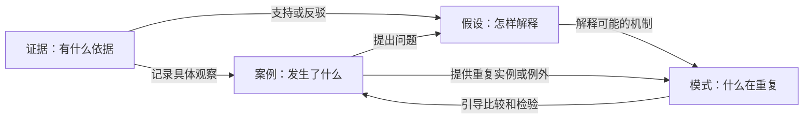

# 理性失序：围绕用户问题的三层产品设计

日期：2026-11-07。方案 v0.2，替代本文件 v0.1；旧稿由 Git 历史保留。

根据用户纠正重新定义三层：审美层先回答帮助用户解决什么问题、用什么认知结构组织体验；功能层匹配这些任务；资产层是用户的知识、信息、材料、关系及其演化记录。视觉语言是审美层的表达手段。

设计依据：原始四类模型 case/evidence/hypothesis/loop、[四类组织示例](../../examples/organization-proposal-example.md)、现有解析与 Loop 投影、[1.9.0 验收](../validation/standalone/readiness.md)。四板块先按原库这四类展开。本文为下一阶段设计，分类、新四板块结构与新导出格式尚未实现。

## 1. 要帮助用户完成什么

理性失序帮助人和 Agent 把散乱的经历、信息和材料，转成有出处、容纳分歧、能复用并持续修订的认识。

用户的问题：

- 我以前遇到过类似情况吗？当时发生了什么，情境有什么不同？
- 当前判断依据是什么？哪些材料支持，哪些提出反例？
- 我如何解释它？还有什么可能，什么会改变这个解释？
- 不同经历里是否存在重复结构？哪些条件成立，哪些情况例外？
- 新材料出现后，哪些旧认识需要复查？怎样交给 Agent 或带到别的工具？

品牌承诺：允许直觉、碎片和冲突解释先进入工作台，让来源、比较与修订帮助认识成形。「失序」体现探索的自由，「理性」体现看清依据、保留边界和回头修正。

## 2. 三层重新定义

| 层 | 决定什么 | 本产品内容 | 设计产物 |
| --- | --- | --- | --- |
| 审美层：用户问题与认知体验 | 为谁解决什么问题，如何组织理解与行动 | 四板块协作、从收录到形成认识的体验、人与 Agent 的关系；视觉与交互表达 | 用户任务图、四板块模型、体验原则与场景 |
| 功能层：能力与流程 | 如何识别、整理、关联、查找、比较、修订和交付 | 解析、单元提取、角色分类、关联、问题工作台、Agent 上下文、修订、导出 | 能力清单、输入输出、自动化边界与 eval |
| 资产层：用户拥有的内容 | 保存什么，如何追溯、复用和迁出 | 原资料、知识单元、角色与关系、研究产出、出处、版本及可交换文件 | 内容模型、来源锚点、版本规则、导出与恢复 |

产品图标、字体、代码与内部测试脚本属于工程支持资源。用户资产以用户积累的内容和关系为中心；用户自己的模板、方法等也可以成为其内容资产。

设计从用户问题出发，功能围绕问题匹配，资产支持功能并保存产生的认识，新的使用经验再反馈到产品设计。

## 3. 四板块是四种认知作用

| 板块 | 用户问题 | 知识单元 | 与其他板块的协作 |
| --- | --- | --- | --- |
| CASE：案例与问题情境 | 具体发生了什么，我在解决哪个问题？ | 事件、经历、调查问题、情境、目标与结果 | 组织相关依据、比较解释，成为模式的实例或反例 |
| EVIDENCE：证据与依据 | 实际观察到了什么，材料原文说了什么？ | 观察记录、可定位引文、数据片段、来源与限制 | 支持或挑战解释/模式，补充案例记录 |
| HYPOTHESIS：假设与解释 | 我如何理解，还有什么可能？ | 观点、因果解释、推测、可检验判断与边界 | 解释案例/模式，连接支持与反驳，随新信息修订 |
| LOOP：重复模式 | 哪种结构在不同情境里反复出现？ | 带实例、触发条件、过程、结果、边界与例外的模式描述 | 比较案例，接受证据与解释的挑战，由新案例检验 |

LOOP 延续原模型的 recurrence 含义，可以包含反馈机制。普通任务流程、提醒或单次复盘，不会仅因步骤成环就自动归为 LOOP。

四块可从任意一块进入。新想法可以先保存为假设，具体经历可以先记成案例，资料可以先收录为待理解材料。系统不要求每个问题都补齐四块。

箭头表示产品协作任务，并非每条都已经是现有解析器支持的关系类型。

## 4. 先识别知识单元，再分类与链接

原始材料保留一份，多个知识单元引用它。一份纪要可能包含事件经过、原话、某人的解释和对重复问题的总结；整个文档的单一归类会丢失这些作用。

原文先可保存和搜索，再围绕实际问题按需提取单元；拆分保留条件、否定、说话者与必要上下文，避免把每句话都变成卡片。概念定义、读书摘录等可以先作为共享资料使用，角色尚不明确时保留待整理状态。

拟议模型：

1. **材料 Asset**：原文件、文本、网页内容等资料，保存来源和内容版本。
2. **知识单元 Unit**：可独立引用的片段或完整声明，有稳定身份，连接一个或多个来源片段。
3. **角色 Role**：单元在特定问题中发挥案例、依据、解释或模式中的什么作用，可有主要与辅助角色。
4. **关系 Relation**：单元间记录的语义连接，保留方向、出处、理由、情境和记录状态。
5. **问题工作台**：围绕一个问题选取相关单元，呈现四块如何支持当前理解。可锚定 CASE，也可从临时查询开始；保存研究结果时再明确生成资产。

主题、项目、时间、人物、资料格式与认知角色分别组织。例如 PDF 是格式，项目 A 是情境，HYPOTHESIS 是内容作用。

论文作者的解释可记录为“作者假设”，实验记录可成为有出处的依据，具体实验情境可构成案例。某人声称“总会发生”时，可记录其模式声明，同时标明目前找到的实例和反例。

引用能证明某个来源表达了某种观点；对观点本身的支持还需检查。分类与引用都不自动提升正确性。

旧 type 与 ID 保留；旧四类可直接提供已声明角色。新 KO 的 kind 保留原意，作为分类线索之一。概念、参考、流程等按实际作用进入四块或留在共享资料，不建立机械的全量转换表。

角色和来源注释通过同一知识契约的版本化扩展表达。读取时不重编号；明确入库或拆分新单元时才生成身份并记录来源。避免新增不相通的对象与刷新体系。

## 5. 功能匹配：从收录到四块可用

流程：收录 → 保留原件/原文 → 识别与引用片段 → 建议角色 → 查找已有知识 → 建议关系 → 四块中使用 → 新材料触发复查。

| 环节 | 输入 | 输出与价值 |
| --- | --- | --- |
| 收录 | 文本、笔记、资料 | 原内容、来源、版本、待整理记录；用户可以先放进来 |
| 单元识别 | 内容与情境 | 事件、观察、解释、模式的分段建议，都能回原文 |
| 分类 | 单元、已有声明、当前问题 | 主/辅助角色及原文依据，允许暂不判断 |
| 关联 | 新旧单元及上下文 | 案例、支持/反驳、模式实例等候选，说明建议理由 |
| 使用 | 问题或 Agent 任务 | 四块相关内容、出处、分歧、缺口和适用条件 |
| 更新 | 新来源、修改、反例 | 需要复查的角色、关系、解释；保留旧版本 |

先利用明确声明、结构与规则，再由外部 Agent 或模型做语义分析。知识库提供一致的结果契约、来源核对和保存方式，不绑定模型产品。无语义服务时仍可按已有声明和人工整理工作。

### 自动化减轻整理负担

- 文件识别、索引、精确重复检测、可重建的分类导航与相似候选，可以自动更新。
- 依据已确认规则的可撤销归类，可按工作区设置自动整理，保留归类理由和撤回入口。
- 解释性质的角色判断、支持/反驳、模式归纳，先保持可辨的建议状态。按材料或主题批量核对，减少逐条处理负担。
- 采用为正式声明的内容按明确保存/提案策略记录；正文、解释、关系变化继续留存版本与实际结果。

自动导航、候选建议、已记录知识分别表达。相似性帮助发现线索；支持、反驳和因果解释需要内容依据。拿不准时说明暂未判断，不填充虚构出处或模式。

## 6. 关系设计

| 产品语义 | 示例 | 与当前契约的关系 |
| --- | --- | --- |
| 来源引用 | 单元引用原资料某个版本/片段 | 使用适用的来源锚点 |
| 观察或出现于 | 观察/模式出现于某案例 | 沿用 observed_in / repeats_in，明确方向与实例范围 |
| 支持 / 反驳 | 依据支持或挑战解释/模式 | 沿用 supports / contradicts，显示出处和理由 |
| 解释 | 假设尝试解释案例或重复模式 | 拟议新语义，需版本化契约与兼容测试后实现 |
| 相关 / 比较 | 用户将两个案例放在一起比较 | 正式相关关系或比较视图；自动相似候选独立标注 |
| 修订 / 替代 | 新解释修订旧解释 | 沿用历史关系并保留先前内容 |

一个逻辑关系可以有多个声明出处。原笔记声明继续可追溯；新增关系应明确唯一写入规则，避免正文、关系文件、索引之间出现冲突权威。

LOOP 展示实例、不同条件、结果和反例。三个相似案例可以产生候选模式，不能直接推出普遍规律。仅一次记录也可明确回答尚不足以观察重复结构。

## 7. 产品界面按认知任务组织

业务主导航规划为 **案例 / 证据 / 假设 / 模式**，切换时保留当前问题或主题范围。共享收件箱、全部资料、Agent 提案、修订历史是工作入口或辅助工具。

两条入口：放入资料时看识别单元、建议归属、可连接知识与出处；输入问题时从四块汇集内容，比较解释和依据，指出缺口。形成或修订的认识保存为可再使用的资产。

四块全局视图与问题工作台共用知识和更新链路。保存或外部修改影响所有相关视图。

| 任务 | 优先显示 |
| --- | --- |
| 理解一个案例 | 事件/观察时间线，相关依据、解释和模式 |
| 核对依据 | 原文与位置，被哪些案例/解释/模式使用 |
| 比较解释 | 并列假设、各自支持与反驳、适用条件 |
| 检验模式 | 跨案例对照：情境、触发条件、过程、结果、差异/反例 |
| 理解问题整体 | 精简关系路径或分组论证图，按需展开 |

四块协同不要求同屏塞满四列。问题总览后聚焦当前任务，右侧保留原文核对。自由画布可作探索补充，默认布局优先表达关系含义和比较任务。

深色橙红档案风格继续保留；标题和构图表达张力，角色、出处、建议/已记录状态保持清楚。视觉方案在业务结构确定后继续迭代。

## 8. 用户资产与关系导出

用户拥有原材料、单元、角色注释、正式关系、来源对应、研究产出和演化记录。正式关系本身也是知识资产。索引、临时相似图、布局、缓存分别定义重建规则。

| 拟议导出 | 用途 | 保留什么 |
| --- | --- | --- |
| 便携知识包 ZIP | 迁移、保存、隔离恢复 | 原件/笔记、身份、角色、关系、出处、版本清单，可选演化记录 |
| 关系 JSON / JSONL | Agent 与程序处理 | 节点、关系与方向、出处、状态、来源版本、工作区命名空间 |
| nodes.csv / relations.csv | 表格审阅与其他图分析工具 | 稳定 ID、角色、关系及可追溯引用字段 |
| Markdown / Mermaid 关系说明 | 分享一个问题、案例或模式 | 选定范围的可读材料、引用和精简关系，标明范围外依赖 |

同一批知识还可输出案例包、观点证据包或模式总结，保留结论、依据与分歧的连接。

关系文件单独导出时保留源引用与缺失清单；完整迁移包包含允许携带的原资料。候选与正式关系分开导出。导入时检查工作区/身份碰撞，先给合并或冲突预览。外置操作者私钥单独安排，不默认进入普通知识分享包。

1.9.0 已有 graph JSON 和带原文的 JSON 导出；这里的便携包导入、CSV、Mermaid 等尚未实现。

## 9. 一条完整示例

虚构场景：放入项目纪要与个人复盘，问“为什么方案经常被推翻？”

1. 保留原件，识别不同项目的改稿事件，形成 CASE 候选。
2. 可定位的原话、修改次数与结果记录形成 EVIDENCE 单元，保留未核对状态。
3. 并列 HYPOTHESIS：“验收标准未对齐”“决策参与者后期变化”，分别连接支持和相反材料。
4. 跨案例比较后提出 LOOP 候选：“过早产出方案 → 各方才暴露分歧 → 返工”，同时呈现标准明确但仍返工的例外。
5. 用户记录当前判断与下一次观察计划。新项目的实际记录回到案例和依据，检验原解释与模式。
6. Agent 后续取得适用案例、依据、竞争解释、模式边界及版本，共同支撑任务。

## 10. 开发顺序与 eval

| 阶段 | 交付 | 验证 |
| --- | --- | --- |
| A. 四板块模型 | 用户问题图、材料/单元/角色/关系契约、旧格式映射、10 份混合文本人工标注 | 如何拆分、跨块使用和暂不判断；身份与出处保持 |
| B. 收录整理 | 文本收件箱、提取、分类和关联候选、批量核对及撤回 | 从放入材料到找到并使用的负担，分类和关系错误 |
| C. 四块问题工作台 | 四块互相跳转、比较与反例、Agent 四块上下文 | 实际问题上能否找到依据、比较解释、保留未知，原文刷新是否一致 |
| D. 关系导出与迁移 | 关系导出、可读问题包，随后完整导出/导入 | ID、角色、方向、来源版本和原文的往返一致性 |
| E. 扩展资料形态 | 实际使用最多的附件或采集方式 | 提取与原件定位一致，再确定 PDF/OCR 等顺序 |

先用少量真实文本贯通四块，再扩大格式、规模和自动化。保留 1.9.0 的版本核对、受控修订和恢复基础。

三层分别评估：

- 审美层/产品问题：用户能否从材料形成可追溯理解、比较解释、看到反例、复用经验；任务完成、误解、回退、步骤与负担。
- 功能层：提取忠实性，角色多标签准确性与应暂不判断情况，关系建议准确性，反驳覆盖，模式实例/例外，检索与 Agent 上下文质量。
- 资产层：原文、身份、出处、关系、历史保持，导入导出一致。错归可撤回，支持/反驳与模式归纳错误单独统计。

开发材料和留出材料按主题/来源家族分开。语义分类与模式归纳需要真实 Agent/模型评测，接口测试不替代内容效果。用户审美、工程回归和知识任务分别记录。

首轮重点：混合角色文档、一份材料跨问题复用、意见与观察混杂、材料不足以归纳模式、反例改变解释、身份重复、新材料触发复查、关系导出往返。

本轮更新设计，运行程序仍为 1.9.0。下一步先完成代表性文本的单元、角色和关系标注，再实现“收录 → 分类链接 → 四块使用 → 关系导出”的最小完整流程。
